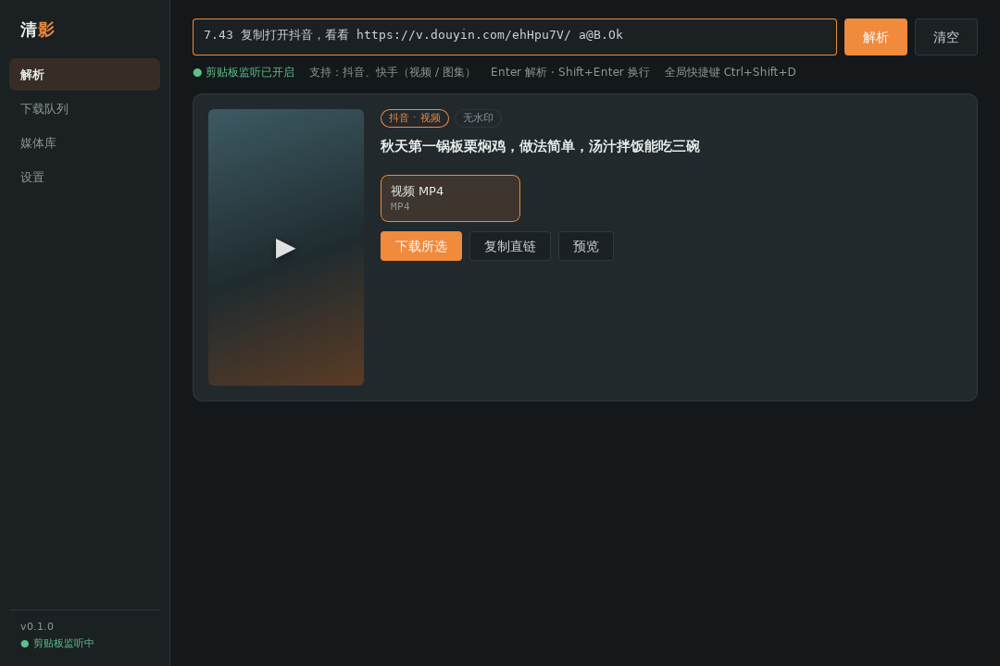
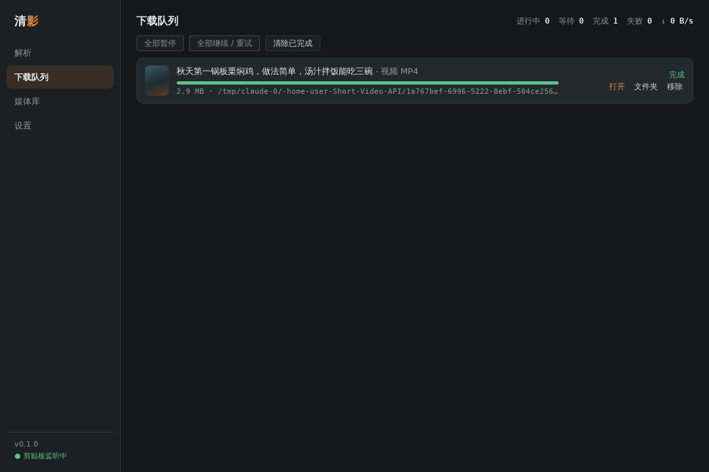
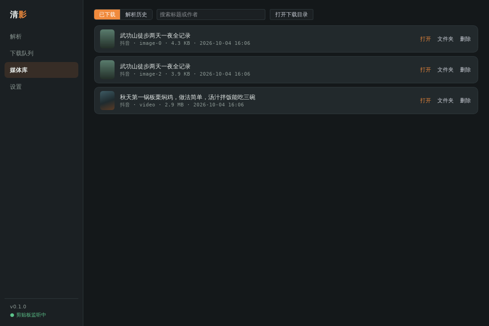
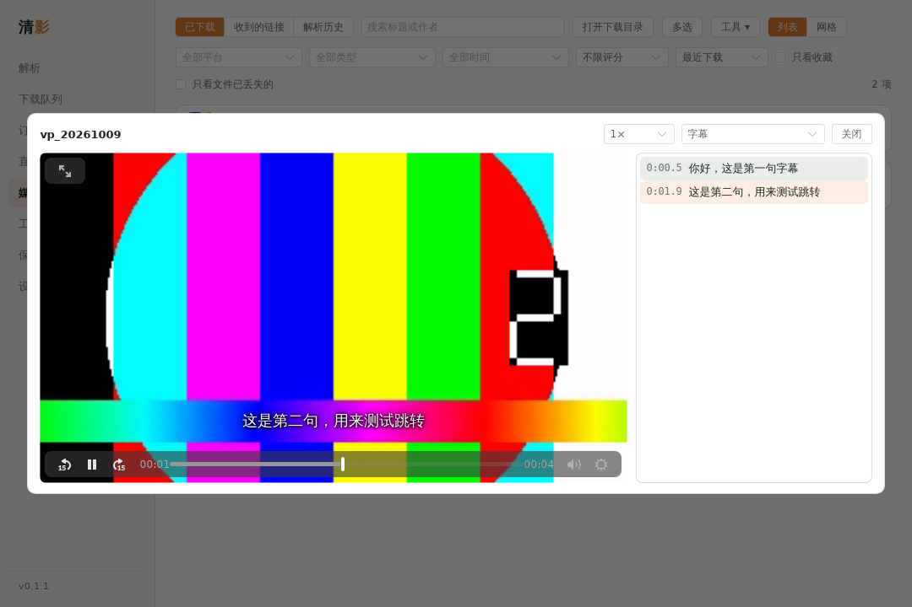
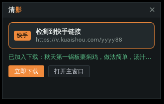

# 清影 ClearClip

[](https://github.com/DiXuanAoYi/ClearClip-Downloader/releases/latest)
[](https://github.com/DiXuanAoYi/ClearClip-Downloader/actions/workflows/desktop-ci.yml)

短视频去水印解析与下载、视频规整与剪辑的桌面程序，支持 Windows / macOS / Linux。粘贴分享链接就能解析和下载；下载之后，还能在同一个程序里整理媒体库、统一视频规格、调色、做时间线剪辑。



## 下载安装

到 [Releases](https://github.com/DiXuanAoYi/ClearClip-Downloader/releases/latest) 下载，不需要编译环境。当前版本 **0.5.1**（[更新记录](desktop/CHANGELOG.md)）。

| 系统 | 下载哪个文件 |
| --- | --- |
| Windows 10 / 11 | `ClearClip_<版本>_x64-setup.exe`（安装版，推荐）或 `.msi`；免安装选 `ClearClip-<版本>-portable-windows-x64.zip` |
| Windows 11 ARM | `ClearClip_<版本>_arm64-setup.exe`；免安装选 `ClearClip-<版本>-portable-windows-arm64.zip` |
| macOS（Apple 芯片和 Intel 通用） | `ClearClip_<版本>_universal.dmg` |
| Linux | `.AppImage`（赋予执行权限后直接运行）、`.deb` 或 `.rpm` |
| 浏览器扩展（Chrome / Edge / Firefox） | `ClearClip-extension-<版本>.zip`，解压后按 [扩展说明](desktop/extension/README.md) 加载 |

首次运行：

- Windows：安装包没有做代码签名，出现“Windows 已保护你的电脑”时，点“更多信息 → 仍要运行”。
- macOS：安装包没有经过 Apple 公证。被拦截时到“系统设置 → 隐私与安全性”点“仍要打开”；提示“已损坏，无法打开”时，在终端执行 `xattr -cr /Applications/ClearClip.app` 后再打开。
- YouTube 等网站需要的 yt-dlp、ffmpeg 在“设置 → 组件”里一键安装，国内网络可以填 GitHub 镜像。程序启动后会通过 GitHub Releases 检查新版本。

发布版只在 Linux 上做过完整的自动化测试，Windows / macOS 靠 CI 编译检查和实际使用反馈；遇到问题请到 [Issues](https://github.com/DiXuanAoYi/ClearClip-Downloader/issues) 反馈，**并附上视频链接和版本号**。

## 能做什么

**解析与下载**

- 内置抖音、快手、小红书、B站、微博、Pixiv 解析，其他上千个网站交给 yt-dlp，还不行时在网页里嗅探 mp4 / m3u8 地址；粘贴整段分享文案就能提取链接，可一次粘贴多条
- 下载队列：并发、分段并行、断点续传、限速、定时、自动重试，直链过期自动重新解析；下载队列、通知、API 和命令行显示的都是按“文件命名”模板生成的文件名
- 剪贴板监听、托盘迷你窗、手机扫码发链接、浏览器扩展“发送到清影”、订阅追更、直播录制、字幕与弹幕、片段与章节下载、播放列表批量选择

**媒体库与工具箱**

- 媒体库：标签、收藏、评分、备注，导入已有文件夹，重复检测，字幕全文搜索，预览图和镜头检测，回收站，备份与还原
- 工具箱：压缩、转 GIF、竖屏转横屏、倍速、响度标准化、拼接、截图、转封装、字幕工具等
- **视频规整**：把来源不同的视频统一成同一规格——HDR 转 SDR、色彩标记修正、自动色阶、`.cube` LUT、去黑边、降噪、防抖、输出电平（16–235 / 0–255）；混剪里偏色的镜头可以自动校正，也能按镜头单独调节
- **LUT 工作室**：用示例图片边看边调，生成新的 `.cube` 3D LUT，可叠加别人的 LUT 或参考一张图片的色调
- **剪辑**：时间线剪辑，多条叠加轨（画中画、贴纸、水印、GIF）、16 种转场、文字、配乐、变速、调色，实时预览，导出 MP4 / MKV；向左 / 向右裁剪、波纹删除、分离音频、逐帧移动、应用到全部片段；还能框出画面里的物体并追踪它，让马赛克、局部调色、跟随取景跟着走

**自动化与安全**

- 自动规则、通知推送（Webhook / Telegram / Bark / 企业微信 / 钉钉 / 飞书等）、自动上传、HTTP 接口、网页控制台、命令行
- 应用锁、老板键、隐私模式、加密保险箱

每一项的详细说明、设置位置和已知限制见 [desktop/README.md](desktop/README.md) 和 [docs/](docs/)：

| 主题 | 文档 |
| --- | --- |
| 视频规整 | [docs/video-normalize.md](docs/video-normalize.md) |
| LUT 工作室 | [docs/lut-studio.md](docs/lut-studio.md) |
| 剪辑 | [docs/video-edit.md](docs/video-edit.md) |
| 媒体库与工具 | [docs/library-and-tools.md](docs/library-and-tools.md) |
| 字幕、片段与章节 | [docs/subtitles-and-clips.md](docs/subtitles-and-clips.md) |
| 自动化与集成 | [docs/automation.md](docs/automation.md) |
| 登录说明 | [docs/login-guide.md](docs/login-guide.md) |
| 手机发链接 | [docs/phone-send.md](docs/phone-send.md) |
| 安全与隐私 | [docs/security-and-privacy.md](docs/security-and-privacy.md) |
| 调试版构建 | [docs/debug-build.md](docs/debug-build.md) |
| 发布流程（签名、更新、扩展上架） | [docs/release-guide/](docs/release-guide/README.md) |

## 界面

| 下载队列 | 媒体库 |
| --- | --- |
|  |  |
| **内置播放器（字幕跳转）** | **托盘迷你窗** |
|  |  |

## 从源码构建

需要 Node.js 20+、Rust 1.80+ 和 [Tauri 的系统依赖](https://tauri.app/start/prerequisites/)。

```bash
cd desktop
npm install
npm run tauri dev      # 开发模式
npm run tauri build    # 打包安装包
```

提交前的检查（`desktop-ci` 在每次提交时也会跑）：`npm run build`、`npm run i18n`、`cargo fmt --check`、`cargo clippy --all-targets -- -D warnings`、`cargo test`。目录结构、数据位置、发布流程见 [desktop/README.md](desktop/README.md)。

## 许可证

[MIT](LICENSE)。使用的第三方开源组件见 [THIRD_PARTY_NOTICES.md](THIRD_PARTY_NOTICES.md)。

## 免责声明

仅用于下载你有权保存的内容。本仓库只为学习研究，如涉及侵犯个人或者团体利益，请与我取得联系，我将主动删除一切相关资料。

邮箱：goliszhou@gmail.com
